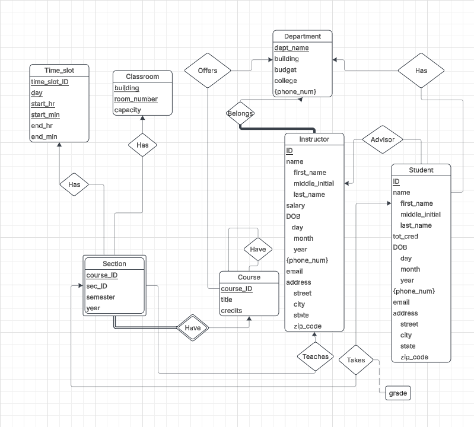

# Database Final Project ReadMe

## Overview

This project somewhat models a university registration database in MySQL. It tracks students, instructors, courses, and sections. It also tracks enrollments and where instructors are assigned as well as grades, prerequisits and advising.

---

## Design

The below ER diagram has many relationships like takes links students to sections and stores grades, teaches links instructors to sections, and a section is identified by course_id, sec_id, semester, and section_year all together.


## Project Files

`create_tables.sql` - Creates the tables the primary keys the foreign keys and the check constraints.

`data.sql` - Populates the tables with sample university data.

`stored_procedures.sql` - THis file has 16 stored procedures for instructor, student, and section CRUD operations, along with student enrollment, instructor assignment, withdrawal, and grade management.

`CURD.sql` - Contains examples for instructor, student, and section operations, plus enrollment, instructor assignment, withdrawal, and grading.

`dbProject.pdf` - Lists what we need to do to comlpete the phases of the assignment.

## MySQL Setup

Open a terminal in the project folder and connect using a MySQL account that can create a database. Replace `YOUR_MYSQL_USER` with your username.

```sh
mysql -u YOUR_MYSQL_USER -p
```

In the MySQL prompt, create a fresh database. Choose an unused name if `university_demo` already exists.

```sql
CREATE DATABASE university_demo;
USE university_demo;
SOURCE create_tables.sql;
SOURCE data.sql;
SOURCE stored_procedures.sql;
```

Check that the sample sections, teaching assignments, and enrollments loaded.

```sql
SELECT COUNT(*) AS sections FROM section;
SELECT COUNT(*) AS teaching_assignments FROM teaches;
SELECT COUNT(*) AS enrollments FROM takes;
```

## Stored Procedures

Retrieve an instructor:
```sql
CALL read_instructor('10001');
```

Retrieve a student:
```sql
CALL read_student('20001');
```

Retrieve a specific course section:
```sql
CALL read_section('CS30002', '1', 'Fall', 2026);
```

Assign a grade to a student:
```sql
CALL record_grade('20001', 'CS10001', '1', 'Fall', 2026, 'A');
```

Withdraw a student from a course:

```sql
CALL withdraw_student('20001', 'CS10001', '1', 'Fall', 2026);
```